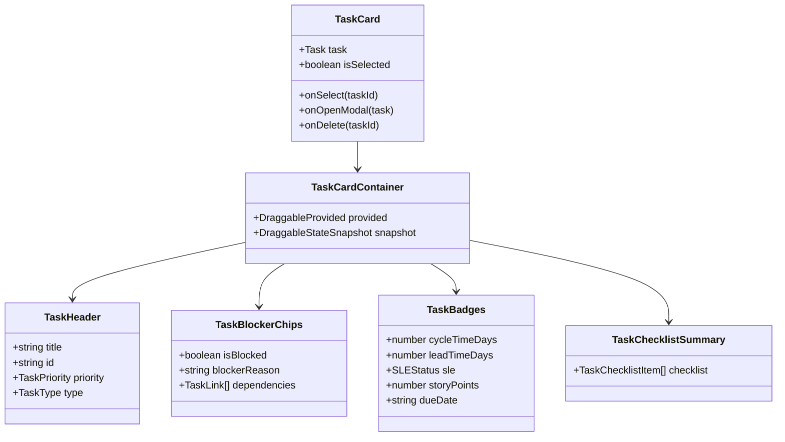
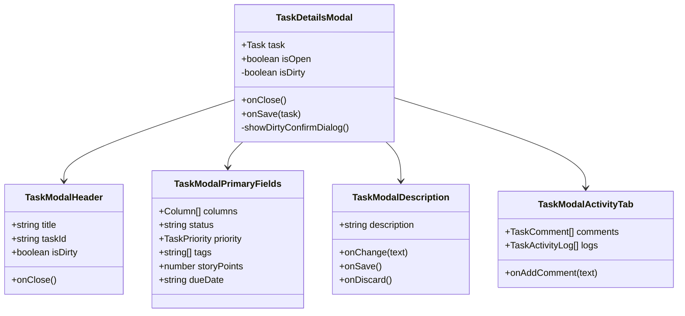
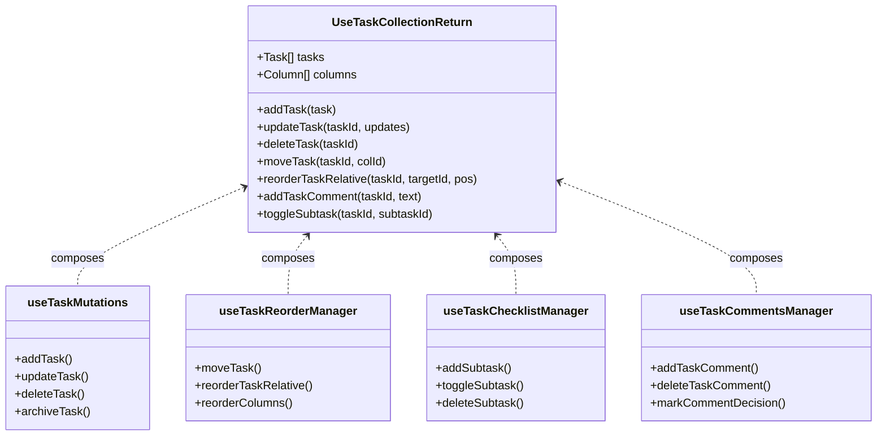
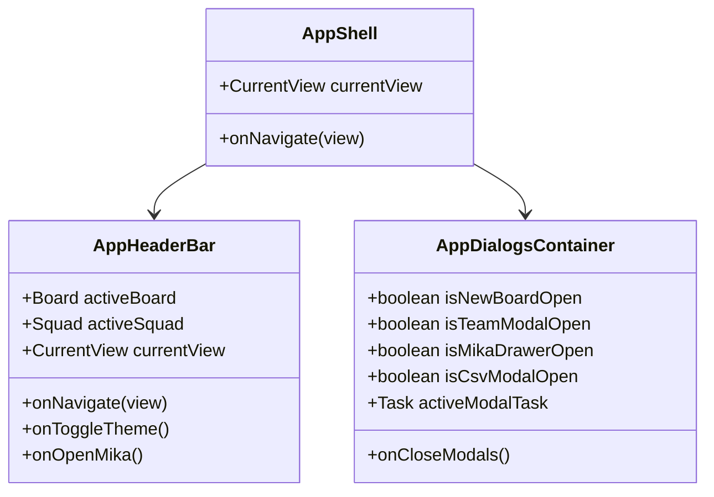

# Component & Hook Architecture Model: Decomposição de Módulos (OPP-002)

**Feature**: `049-modular-decomposition`  
**Status**: Complete  
**Date**: 2026-10-21  
**Spec**: [spec.md](./spec.md) | **Research**: [research.md](./research.md)

---

## 1. Modelo de Composição do Cartão Kanban (`Task/`)



### Contratos de Props

```typescript
// src/components/Task/types.ts
export interface TaskCardProps {
  task: Task;
  index: number;
  columns: Column[];
  allTasks: Task[];
  isSelected?: boolean;
  onSelect?: (taskId: string, e: React.MouseEvent) => void;
  onOpenModal: (task: Task) => void;
  onDelete: (taskId: string) => void;
  onMoveTask?: (taskId: string, targetColId: string) => void;
}

export interface TaskHeaderProps {
  task: Task;
  onOpenModal: (task: Task) => void;
  onDelete: (taskId: string) => void;
}

export interface TaskBadgesProps {
  task: Task;
  column?: Column;
}

export interface TaskBlockerChipsProps {
  task: Task;
  allTasks: Task[];
  onOpenModal: (task: Task) => void;
}

export interface TaskChecklistSummaryProps {
  checklist?: TaskChecklistItem[];
  onToggleItem?: (itemId: string) => void;
}
```

---

## 2. Modelo de Composição do Modal de Detalhes (`TaskDetailsModal/`)



### Contratos de Props

```typescript
// src/components/TaskDetailsModal/types.ts
export interface TaskModalHeaderProps {
  task: Task;
  isDirty: boolean;
  onClose: () => void;
}

export interface TaskModalPrimaryFieldsProps {
  task: Task;
  columns: Column[];
  onChangeField: <K extends keyof Task>(field: K, value: Task[K]) => void;
}

export interface TaskModalDescriptionProps {
  description: string;
  isEditing: boolean;
  autoSaveEnabled: boolean;
  onSaveDescription: (desc: string) => void;
  onDiscardDescription: () => void;
}

export interface TaskModalActivityTabProps {
  task: Task;
  activeTab: 'comments' | 'activity';
  onTabChange: (tab: 'comments' | 'activity') => void;
  onAddComment: (comment: string, isDecision?: boolean) => void;
}
```

---

## 3. Modelo de Composição do Hook Fachada (`useTaskCollection`)



---

## 4. Modelo de Composição da Casca da Aplicação (`App/`)


