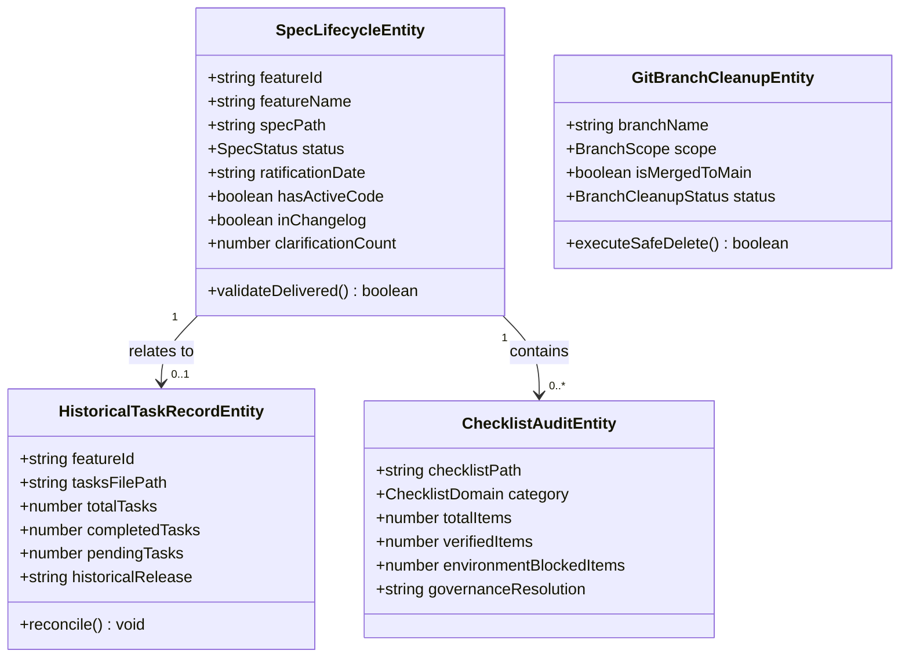
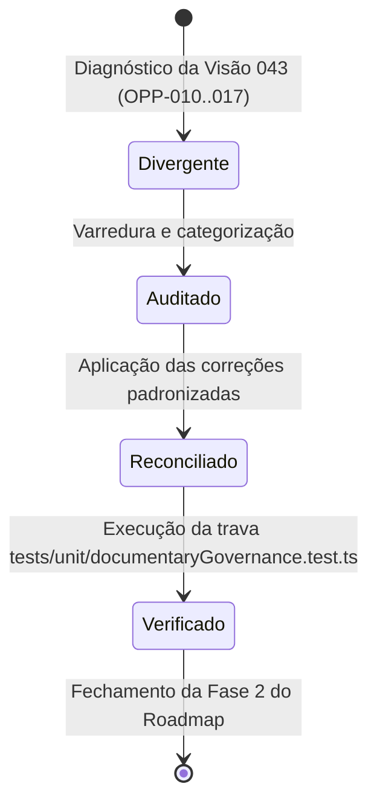

# Data Model & Governance Schemas: Reconciliação Documental de Artefatos

**Feature**: `050-artifact-governance-reconciliation`  
**Date**: 2026-10-21  
**Status**: Completed  

---

## 1. Visão Geral das Entidades de Governança

Esta especificação trata de artefatos de governança documental e referências de controle de versão (Git). O modelo de dados formaliza as entidades inspecionadas e mutadas pelas rotinas de reconciliação.

---

## 2. Definição das Entidades e Atributos

### 2.1 `SpecLifecycleEntity` (Ciclo de Vida da Especificação)

Representa um documento `specs/<NNN-slug>/spec.md`.

| Atributo | Tipo | Descrição | Regra de Validação |
|---|---|---|---|
| `featureId` | `string` | Prefixo numérico de 3 dígitos (ex: `"001"`, `"023"`) | Regex `/^\d{3}$/` |
| `featureName` | `string` | Slug nominal da feature (ex: `"team-access-control"`) | Kebab-case |
| `specPath` | `string` | Caminho relativo ao repo (ex: `"specs/023-team-access-control/spec.md"`) | Arquivo existente |
| `status` | `enum` | Estado formal do ciclo de vida | `Draft` \| `Ready for Planning` \| `In Progress` \| `Implemented & Verified` |
| `ratificationDate` | `string` | Data de ratificação ou reconciliação | Formato ISO `YYYY-MM-DD` |
| `hasActiveCode` | `boolean` | Código presente na linha principal `main` | Verificado via Git |
| `inChangelog` | `boolean` | Capacidade citada em `CHANGELOG.md` | Critério FR-024(b) |
| `clarificationCount`| `number` | Contagem de tags `[NEEDS CLARIFICATION]` no arquivo | Deve ser `0` para specs entregues |

**Invariante de Entrega (FR-024)**:
$$\text{hasActiveCode} \land \text{inChangelog} \iff \text{status} = \text{"Implemented \& Verified"}$$

---

### 2.2 `HistoricalTaskRecordEntity` (Artefato de Tarefas Históricas)

Representa os arquivos de tarefas em `specs/005` a `specs/009` (`tasks.md`).

| Atributo | Tipo | Descrição | Estado Alvo |
|---|---|---|---|
| `featureId` | `string` | `"005"` a `"009"` | Intervalo fixo |
| `tasksFilePath` | `string` | `"specs/00X-.../tasks.md"` | Arquivo existente |
| `totalTasks` | `number` | Contagem de tarefas declaradas | 55 tarefas no agregado |
| `completedTasks` | `number` | Contagem de checkboxes `- [x]` | 55 tarefas (100%) |
| `pendingTasks` | `number` | Contagem de checkboxes `- [ ]` | **0 tarefas** |
| `historicalRelease`| `string` | Versão de lançamento de consolidação | `"v0.1.0"` |

---

### 2.3 `ChecklistAuditEntity` (Auditoria de Checklist de Revisão)

Representa cada checklist em `specs/*/checklists/*.md`.

| Atributo | Tipo | Descrição |
|---|---|---|
| `checklistPath` | `string` | Caminho do arquivo de checklist |
| `category` | `enum` | `Requirements` \| `AccessControl` \| `BrowserParity` \| `SubtasksComments` \| `HeaderAccessibility` \| `BoardManagement` \| `Autosave` \| `UxAudit` \| `Ux` \| `PlanningReadiness` |
| `totalItems` | `number` | Contagem total de checkboxes no arquivo |
| `verifiedItems` | `number` | Quantidade de itens atestados no código / testes (`- [x]`) |
| `environmentBlockedItems` | `number` | Quantidade de itens com bloqueio físico de host (ex: WebKit no Windows) |
| `governanceResolution`| `string` | Nota declarativa fundamentando o status e citando o Artigo Constitucional aplicável |

---

### 2.4 `GitBranchCleanupEntity` (Higienização de Ramificação de Trabalho)

Representa uma branch no repositório local ou remoto.

| Atributo | Tipo | Descrição | Regra de Execução |
|---|---|---|---|
| `branchName` | `string` | Nome da branch (ex: `"019-monte-carlo-simulation"`) | Kebab-case |
| `scope` | `enum` | `Local` ou `Remote` (`origin`) | - |
| `isMergedToMain` | `boolean` | Verificação determinística via `git branch --merged main` | **Obrigatório true** para exclusão |
| `status` | `enum` | `Cleaned` \| `FailedSafe` \| `PendingManualPrune` | Atualizado pós-execução |

---

## 3. Matriz de Estados e Transições

