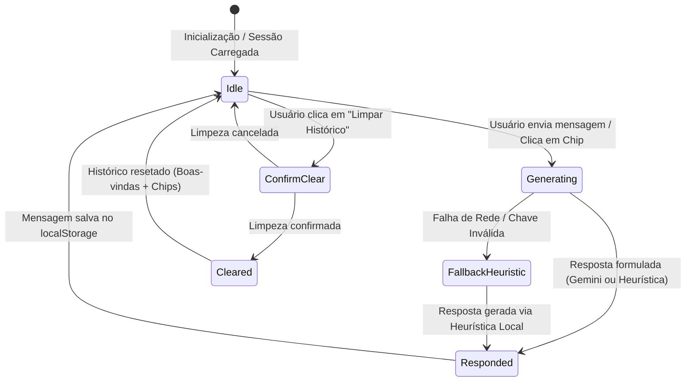

# Data Model: Mika Conversational AI Chat Copilot (Feature 052)

**Feature Branch**: `052-mika-ai-chat`  
**Date**: 2026-10-29  
**Status**: Completed  
**Spec Reference**: [spec.md](./spec.md)

---

## 1. Domain Entities & Type Definitions

```typescript
/**
 * Papel do emissor na conversa com a Mika
 */
export type MikaChatRole = 'user' | 'assistant' | 'system';

/**
 * Provedor de inteligência utilizado para formular a resposta
 */
export type MikaChatProvider = 'gemini' | 'heuristic';

/**
 * Categoria temática de perguntas rápidas da Mika
 */
export type MikaQuickPromptCategory = 
  | 'bottleneck' 
  | 'sle' 
  | 'blocked' 
  | 'throughput' 
  | 'general';

/**
 * Entidade individual de mensagem no histórico do chat
 */
export interface MikaChatMessage {
  /** Identificador único da mensagem (ex.: 'msg_1730198400000_abc123') */
  id: string;

  /** Papel do emissor */
  role: MikaChatRole;

  /** Conteúdo textual da mensagem formatado em markdown ou texto simples */
  content: string;

  /** Data e hora de criação em formato ISO 8601 */
  timestamp: string;

  /** Provedor responsável pela formulação da resposta */
  provider: MikaChatProvider;

  /** IDs de tarefas do quadro mencionadas no corpo da mensagem */
  referencedTaskIds?: string[];
}

/**
 * Sessão de histórico persistida por quadro
 */
export interface MikaChatSession {
  /** Identificador do quadro/squad ao qual o diálogo pertence */
  boardId: string;

  /** Lista cronológica de mensagens (máximo 30 em regime FIFO) */
  messages: MikaChatMessage[];

  /** Timestamp da última interação gravada */
  updatedAt: string;
}

/**
 * Chip de sugestão de pergunta com envio em 1 clique
 */
export interface MikaQuickPrompt {
  id: string;
  label: string;
  query: string;
  category: MikaQuickPromptCategory;
  icon?: string;
}

/**
 * Snapshot estruturado da telemetria do quadro para montagem do contexto analítico
 */
export interface MikaBoardTelemetryContext {
  boardId: string;
  boardTitle: string;
  columns: {
    id: string;
    title: string;
    wipLimit?: number;
    taskCount: number;
    isOverWip: boolean;
    avgStageTimeHours?: number;
  }[];
  blockedTasks: {
    id: string;
    title: string;
    columnTitle: string;
    reason?: string;
    blockedHours: number;
  }[];
  cycleTimeP85Days: number | null;
  throughputLast14Days: number;
  totalActiveTasks: number;
  totalCompletedTasks: number;
  generatedAt: string;
}
```

---

## 2. Invariantes de Armazenamento & Ciclo de Vida

### Chave de Armazenamento Local
- Cada sessão é persistida em `localStorage` com a chave:
  `metrik_mika_chat_${boardId}`
- A aba selecionada na gaveta é persistida com a chave:
  `metrik_mika_drawer_tab` (valores permitidos: `'chat' | 'insights'`, padrão: `'chat'`).

### Regras de Validação & Restrições (Invariantes)
1. **Regra FIFO de Capacidade Máxima**:
   - `messages.length <= 30`.
   - Se uma nova mensagem for adicionada fazendo o tamanho exceder 30, as mensagens mais antigas (`messages[0]`) são descartadas sequencialmente até que o tamanho retorne a 30.
2. **Janela Contextual de Envio à API Gemini**:
   - Ao formular a requisição para a Google Gemini API, o cliente seleciona no máximo as **últimas 6 mensagens** da sessão (3 pares usuário-assistente), filtrando mensagens com `role === 'system'`.
3. **Não-Mutação de Dados do Quadro**:
   - Nenhuma mensagem, sugestão ou clique na interface do chat pode alterar diretamente status, posições ou limites de tarefas do quadro Kanban (Princípio IX). A única mutação permitida é o acionamento de `onOpenTaskDetails(taskId)`, delegando a edição ao usuário.
4. **Isolamento por Squad/Quadro**:
   - Mensagens de um `boardId` jamais devem ser expostas ou renderizadas em outro `boardId` (Princípio VIII). Ao alternar o quadro ativo no Metrik, o chat recarrega a sessão correspondente ao novo `boardId`.

---

## 3. Máquina de Estados da Conversa no Chat


