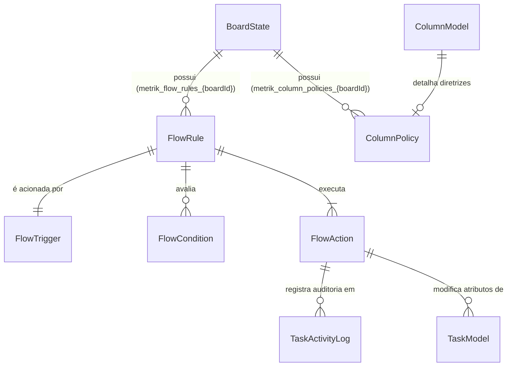
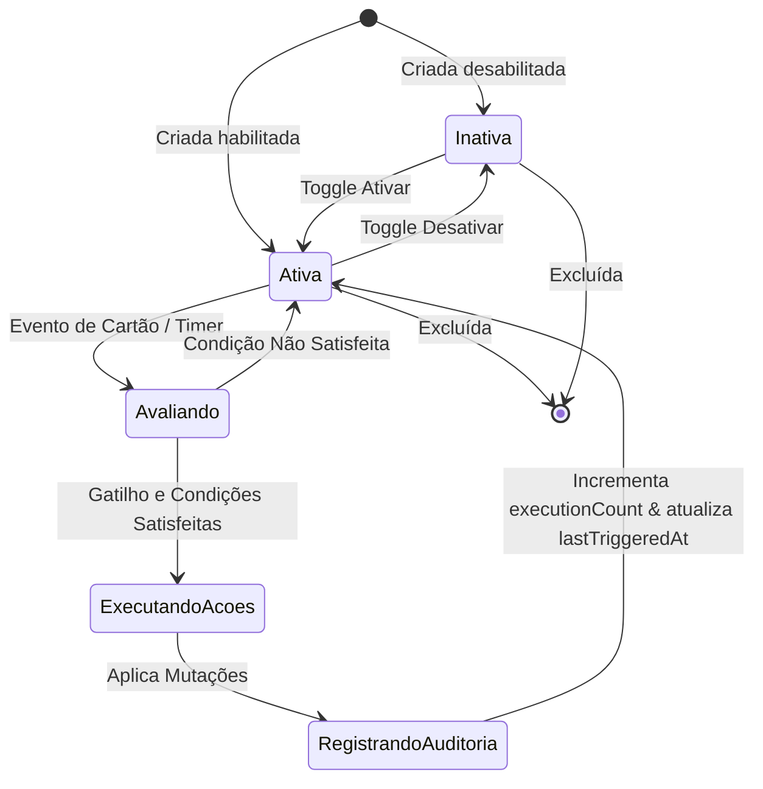

# Data Model: Automações de Fluxo & Políticas de Cartão

**Feature**: `053-flow-automation-policies`
**Date**: 2026-11-02
**Status**: Concluído

---

## 1. Entidades Principais

### 1.1 `FlowRule` (Regra de Automação)
Representa uma regra de governança ou automação sem código no quadro.

| Campo | Tipo | Obrigatório | Descrição |
|---|---|---|---|
| `id` | `string` | Sim | Identificador único (UUID v4 / nanoid) |
| `boardId` | `string` | Sim | ID do quadro ao qual a regra pertence |
| `name` | `string` | Sim | Nome descritivo da regra (ex: "Alerta de Aging em Progresso") |
| `description` | `string` | Não | Explicação detalhada do propósito da regra |
| `enabled` | `boolean` | Sim | Flag que define se a regra está ativa para execução |
| `trigger` | `FlowTrigger` | Sim | Especificação do evento que aciona a avaliação |
| `conditions` | `FlowCondition[]` | Sim | Lista de condições adicionais que devem ser verdadeiras (AND) |
| `actions` | `FlowAction[]` | Sim | Lista de ações a serem executadas se as condições forem atendidas |
| `createdAt` | `string` | Sim | ISO 8601 timestamp de criação |
| `updatedAt` | `string` | Sim | ISO 8601 timestamp da última alteração |
| `lastTriggeredAt` | `string` \| `null` | Não | Timestamp da última vez que a regra executou uma ação |
| `executionCount` | `number` | Sim | Contador cumulativo de execuções com sucesso |

---

### 1.2 `FlowTrigger` (Gatilho da Regra)
Define o evento disparador.

| Campo | Tipo | Descrição |
|---|---|---|
| `type` | `FlowTriggerType` | Tipo do evento disparador |
| `config` | `FlowTriggerConfig` | Configurações específicas para o tipo de gatilho |

#### Tipos de Gatilho (`FlowTriggerType`)
- `'card_moved'`: Disparado quando um cartão é movido de coluna.
- `'block_status_changed'`: Disparado quando o status de bloqueio do cartão é alterado.
- `'card_created'`: Disparado na criação de um novo cartão.
- `'aging_threshold_exceeded'`: Disparado periodicamente se o tempo em coluna exceder o limiar.
- `'due_date_approaching'`: Disparado periodicamente se o vencimento estiver a menos de X horas.

#### Configuração do Gatilho (`FlowTriggerConfig`)
```typescript
export interface FlowTriggerConfig {
  /** Coluna destino específica ou '*' para qualquer */
  targetColumnId?: string;
  /** Categoria da coluna destino ('todo' | 'in_progress' | 'done') */
  targetColumnCategory?: ColumnCategory;
  /** Limiar de tempo em dias para envelhecimento (aging) */
  agingThresholdDays?: number;
  /** Limiar de tempo em horas para proximidade de prazo */
  dueHoursThreshold?: number;
  /** Filtrar por estado de bloqueio ('blocked' | 'unblocked' | 'any') */
  blockStatus?: 'blocked' | 'unblocked' | 'any';
}
```

---

### 1.3 `FlowCondition` (Condição de Filtragem)
Filtro booleano aplicado ao cartão sob avaliação.

| Campo | Tipo | Descrição |
|---|---|---|
| `field` | `FlowConditionField` | Campo avaliado (`'priority'`, `'tags'`, `'type'`, `'assignee'`, `'columnCategory'`) |
| `operator` | `FlowConditionOperator` | Operador (`'equals'`, `'not_equals'`, `'contains'`, `'not_contains'`, `'is_empty'`, `'is_not_empty'`) |
| `value` | `string` \| `string[]` \| `undefined` | Valor de comparação |

---

### 1.4 `FlowAction` (Ação Automatizada)
Efeito produzido no cartão quando a regra é validada.

| Campo | Tipo | Descrição |
|---|---|---|
| `type` | `FlowActionType` | Operação a executar |
| `payload` | `FlowActionPayload` | Parâmetros da ação |

#### Tipos de Ação (`FlowActionType`)
- `'add_tag'`: Adiciona tag(s) ao cartão (se já não estiver presente).
- `'remove_tag'`: Remove tag(s) do cartão.
- `'set_priority'`: Altera a prioridade do cartão (`'low'`, `'medium'`, `'high'`, `'urgent'`).
- `'set_blocked'`: Marca o cartão como impedido com um motivo padronizado.
- `'set_unblocked'`: Remove o impedimento do cartão.
- `'notify_toast'`: Exibe notificação toast na interface informando os membros.
- `'highlight_card'`: Ativa badge visual de atenção de política no cartão.

---

### 1.5 `ColumnPolicy` (Políticas Explícitas de Coluna)
Definições de Definition of Ready (DoR) e Definition of Done (DoD) visíveis no cabeçalho.

| Campo | Tipo | Descrição |
|---|---|---|
| `columnId` | `string` | ID da coluna associada |
| `entryCriteria` | `string` | Critérios de entrada (DoR) para puxar um item para esta coluna |
| `exitCriteria` | `string` | Critérios de saída (DoD) para passar um item adiante |
| `updatedAt` | `string` | ISO 8601 da última atualização |

---

## 2. Diagrama de Relacionamento de Entidades



---

## 3. Máquina de Estados e Ciclo de Vida da Regra



---

## 4. Validações e Regras de Negócio

1. **Unicidade e Nomes**: O nome da regra deve ter entre 3 e 60 caracteres e não pode ser vazio.
2. **Ao Menos Uma Ação**: Toda regra deve possuir pelo menos uma `FlowAction` válida cadastrada.
3. **Idempotência**: Se uma ação for "adicionar tag X" e o cartão já contiver a tag X, a mutação não deve gerar log duplicado nem sujar o histórico.
4. **Isolamento por Quadro**: Regras de um quadro nunca são avaliadas para eventos de outro quadro.
5. **Profundidade Única**: Nenhuma ação resultante de automação dispara novos gatilhos (`isAutomated: true`).
