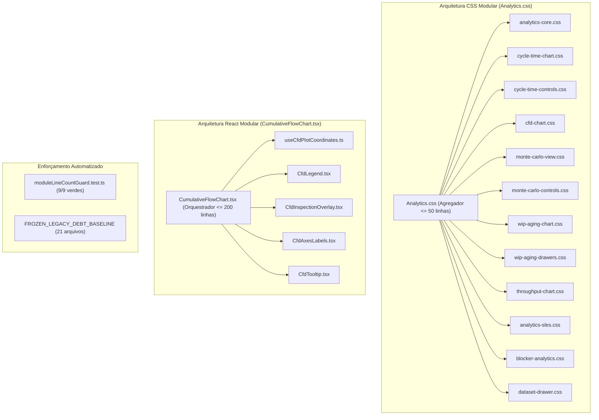

# Plano de Implementação — Feature 059: Quitação de Dívida Técnica Legada Congelada

## 1. Visão Arquitetural

A decomposição visa transformar dois monólitos legados em conjuntos coesos de componentes e folhas de estilo orientadas a domínio, sem alterar qualquer contrato externo, classe CSS, marcação de acessibilidade ou teste unitário.

## 2. Estratégia de Particionamento CSS

Para garantir que cada folha de estilo respeite o limite de 400 linhas:
- O particionamento seguirá rigorosamente os blocos de comentários já existentes em `Analytics.css`.
- Para o bloco de Cycle Time (~843 linhas), dividiremos em `cycle-time-chart.css` (SVG, linhas, pontos) e `cycle-time-controls.css` (dropdown, gaveta de controles, switches, chips).
- Para o bloco de Monte Carlo (~410 linhas), dividiremos em `monte-carlo-view.css` (layout, cartões) e `monte-carlo-controls.css` (controles, histograma).
- Para o bloco de WIP Aging (~564 linhas), dividiremos em `wip-aging-chart.css` (canvas SVG, faixas) e `wip-aging-drawers.css` (gavetas retráteis e seletores).
- `Analytics.css` conterá exclusivamente `@import './analytics/...';` na ordem sequencial exata do arquivo original.

## 3. Estratégia de Particionamento React

1. `useCfdPlotCoordinates.ts`: Extrai a matemática de cálculo de coordenadas, `displayedData` baseado em scrubber, polígonos dinâmicos por etapa e o objeto `inspection` (WIP vertical, Lead Time horizontal com cálculo de dias e alerta de expansão de fila).
2. `CfdLegend.tsx`: Componente puro para renderizar a barra superior de legendas de colunas/estágios.
3. `CfdInspectionOverlay.tsx`: Componente SVG puro que renderiza as linhas pontilhadas, linhas sólidas de WIP, caixas de contagem, setas bidirecionais de Lead Time e tag de gargalo.
4. `CfdAxesLabels.tsx`: Componente HTML que renderiza os rótulos de grade vertical no eixo Y e as 3 datas principais no eixo X.
5. `CfdTooltip.tsx`: Componente HTML que renderiza o card flutuante posicionado sobre as coordenadas ativas do cursor.
6. `CumulativeFlowChart.tsx`: Mantém o SVG principal, o `CfdFilterDrawer`, o `CfdTimelineScrubber` e orquestra os subcomponentes.
