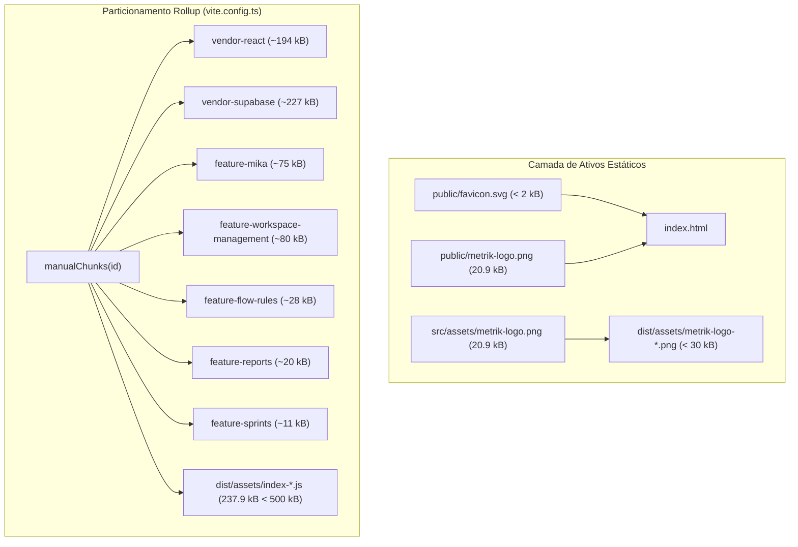

# Plano de Implementação — Feature 060: Otimização de Peso de Entrada e Particionamento de Bundle

## 1. Visão Arquitetural

A otimização de entrada atua em duas frentes independentes: camada de ativos estáticos (*assets*) e camada de empacotamento Rollup/Vite (*bundling*).

## 2. Decisões Técnicas

1. **Favicon SVG**: Criado arquivo vetorial `public/favicon.svg` contendo o símbolo semântico das três colunas do Kanban com curva ascendente de métricas de fluxo sobre gradiente noturno.
2. **Compressão PNG**: Reamostragem via Lanczos para 160x160 pixels com canal alfa preservado e nível de compressão máximo (compress_level=9) via Pillow.
3. **Rollup manualChunks**: Estruturação de limites modulares por subsistema no `vite.config.ts`, permitindo que os modais e painéis pesados sejam carregados sob demanda ou em paralelo, reduzindo o chunk principal `index-*.js` de 634,7 kB para 237,9 kB.
